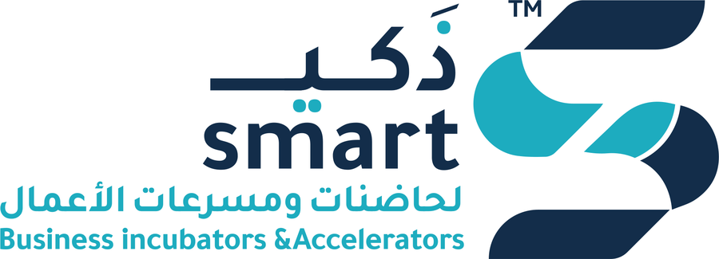

<p align="center"></p>

# smart Meet — منصة اجتماعات ذكي لحاضنات ومسرعات الأعمال

نظام اجتماعات فيديو كامل بهوية **ذكي smart**، يعمل من المتصفح على الموبايل والكمبيوتر بدون تثبيت أي تطبيق، بواجهة عربية (RTL)، مع مساعد ذكي وترجمة فورية بالذكاء الاصطناعي.

## المميزات
| الميزة | الوصف |
|---|---|
| 🎥 فيديو وصوت | اتصال مباشر بين المشاركين (WebRTC) بجودة حتى 720p |
| 🎙️ الميكروفون / الكاميرا | تشغيل وإيقاف، مع شاشة معاينة قبل الدخول |
| 🖥️ مشاركة الشاشة | تظهر الشاشة المشتركة في المنتصف بشكل مكبّر |
| 💬 المحادثة | رسائل نصية فورية مع إشعار بالرسائل غير المقروءة |
| 👥 المشاركون | قائمة بالحضور وحالة الميكروفون والكاميرا لكل واحد |
| ⏺️ تسجيل | تسجيل الاجتماع كله (كل الفيديوهات + كل الأصوات) وحفظه على جهازك، ويظهر للجميع تنبيه "جاري التسجيل" |
| ✨ المساعد الذكي | يلخّص الاجتماع، ويطلع القرارات والمهام ومسؤول كل مهمة، ويجاوب على أي سؤال عن اللي اتقال — ويقدر يشارك رده في المحادثة |
| 🌐 الترجمة | تحويل الكلام لنص مباشرةً يظهر لكل المشاركين، مع **تصحيح ذكي** لغلطات التعرف على الكلام، + ترجمة فورية لـ 9 لغات (كل شخص يختار لغته) |
| 📄 محضر الاجتماع | سجل تلقائي للدخول والخروج والمحادثة والكلام، قابل للتحميل كملف نصي، مع زر "ملخص ذكي" |
| ✋ رفع اليد | مع تنبيه لباقي المشاركين |
| 😀 التفاعلات | إيموجي متحركة تظهر للجميع |
| 🔗 دعوة | مشاركة رابط الاجتماع (واتساب وغيره) أو نسخه |
| ⚙️ الإعدادات | تغيير الاسم، واختيار الميكروفون والكاميرا، ولغة الترجمة |
| 👑 تحكم المنظّم | غرفة انتظار، كتم صوت الجميع أو شخص، إخراج مشارك، قفل الاجتماع، وتعيين منظّم مشارك |
| 📨 ملخص بعد الاجتماع | لما المنظّم ينهي الاجتماع: ملخص ذكي (نظرة عامة، قرارات، مهام، خطوات تالية) يظهر للكل ويتبعت على إيميلات الحضور بلغتهم، مع زرار مشاركة على واتساب |
| 🔐 كود الشركة | الموظفين بس يقدروا يعملوا اجتماعات جديدة، والضيوف يدخلوا بالرابط الموقّع من غير كود. وفيه حماية من التخمين |
| ⏱️ مؤقت وحالة الاتصال | مدة الاجتماع، وعدد المشاركين، وإعادة الاتصال تلقائيًا |

## التشغيل على جهازك
```bash
npm install
npm start
```
ثم افتح: http://localhost:3000

## تفعيل الذكاء الاصطناعي (المساعد + الترجمة)
الخدمتين شغالين بـ **Claude** من Anthropic. كل اللي محتاجه:
1. اعمل حساب على https://console.anthropic.com وخد **API Key**.
2. شغّل الخادم ومعاه المفتاح:
   ```bash
   ANTHROPIC_API_KEY=sk-ant-... npm start
   ```
لو المفتاح مش موجود، النظام كله بيشتغل عادي، وبيظهر تنبيه إن المساعد والترجمة مش مفعّلين.

## الهوية البصرية
- **الشعار:** الملفات في `public/img/` (الشعار الأصلي، ونسخة للخلفيات الداكنة، ورمز S، وأيقونات التطبيق).
- **الأسماء:** `public/js/config.js`
- **الألوان:** أول جزء في `public/css/style.css` — تركواز ذكي `#1faec1` وكحلي ذكي `#132e4d`.

## النشر على الإنترنت
> 📘 **دليل النشر خطوة بخطوة على `meet.startupsmart.net`: [DEPLOY.md](DEPLOY.md)**

> ⚠️ الكاميرا والميكروفون **لا يعملان إلا عبر HTTPS** (أو localhost).

- أي استضافة تدعم Node.js (Render, Railway, Fly.io, VPS) — أمر التشغيل `npm start`.
- أو باستخدام Docker:
  ```bash
  docker build -t smart-meet .
  docker run -p 3000:3000 -e ANTHROPIC_API_KEY=sk-ant-... smart-meet
  ```
  ثم ضعه خلف Nginx/Caddy مع شهادة SSL ودومين مثل `meet.yourcompany.com`.

### متغيرات البيئة
| المتغير | الوصف | الافتراضي |
|---|---|---|
| `PORT` | المنفذ | `3000` |
| `ACCESS_CODE` | كود الشركة: مطلوب لإنشاء اجتماع جديد (الدخول بالرابط مفتوح للضيوف). لو فاضي، أي حد يقدر يعمل اجتماع | — |
| `SMTP_HOST` / `SMTP_PORT` / `SMTP_USER` / `SMTP_PASS` | إيميل لإرسال ملخصات الاجتماعات (مثلاً إيميل من cPanel: `mail.startupsmart.net` و `465`) | — |
| `SMTP_FROM` | اسم وعنوان المرسل (اختياري) | `"smart Meet \| ذكي" <SMTP_USER>` |
| `PUBLIC_URL` | رابط الموقع لزرار "فتح نظام الاجتماعات" في الإيميل (اختياري) | — |
| `ROOM_SECRET` | اختياري: مفتاح توقيع روابط الاجتماعات. لو مش موجود بيتعمل من `ACCESS_CODE`، يعني تغيير الكود بيلغي الروابط القديمة | — |
| `ANTHROPIC_API_KEY` | مفتاح Claude لتفعيل المساعد الذكي والترجمة | — |
| `AI_MODEL` | موديل المساعد الذكي | `claude-opus-5-5` |
| `TRANSLATE_MODEL` | موديل الترجمة الفورية وتصحيح الكلام المكتوب | `claude-haiku-5-5` |
| `TRANSLATE_EFFORT` | جودة الترجمة: `low` (أسرع وأرخص) / `medium` / `high` (أدق) | `medium` |
| `CAPTION_CORRECTION` | اكتب `off` لإيقاف التصحيح الذكي للكلام المكتوب | مفعّل |
| `MAX_PARTICIPANTS` | أقصى عدد في الاجتماع الواحد | `8` |
| `TURN_URL` | عنوان خادم TURN (يمكن أكثر من عنوان مفصولة بفاصلة) | — |
| `TURN_USERNAME` / `TURN_PASSWORD` | بيانات دخول خادم TURN | — |

**مهم للإنتاج:** بعض الشبكات (شبكات الشركات وبعض شبكات الموبايل) تمنع الاتصال المباشر، فيلزم خادم **TURN**
(مثل [coturn](https://github.com/coturn/coturn) على سيرفرك، أو خدمة جاهزة مثل Twilio / Metered / Cloudflare).

## البنية التقنية
- `server.js` — خادم Express + Socket.IO (تنظيم الغرف وتوصيل المشاركين وسجل الاجتماع).
- `ai.js` — خدمات الذكاء الاصطناعي (المساعد والترجمة).
- `public/index.html` — الصفحة الرئيسية (إنشاء اجتماع / الانضمام بكود).
- `public/manifest.webmanifest` — يخلي الموقع يتثبت على الموبايل كتطبيق بأيقونة ذكي.
- `public/room.html` + `public/js/room.js` — غرفة الاجتماع.
- الاتصال بنظام **Mesh**: كل مشارك متصل مباشرة بالباقين، وهذا مناسب حتى ~8 أشخاص.
  للاجتماعات الأكبر يمكن لاحقًا إضافة خادم SFU (مثل LiveKit أو mediasoup).

## ملاحظات
- التسجيل يُحفظ على جهاز الشخص الذي ضغط "تسجيل" (ملف webm/mp4).
- تحويل الكلام لنص يعتمد على خاصية التعرّف على الكلام في المتصفح (Chrome وEdge وSafari).
- المساعد بيعتمد على المحادثة والكلام المكتوب؛ علشان "يسمع" الاجتماع لازم المتكلمين يفعّلوا تحويل الكلام لنص من لوحة الترجمة.
