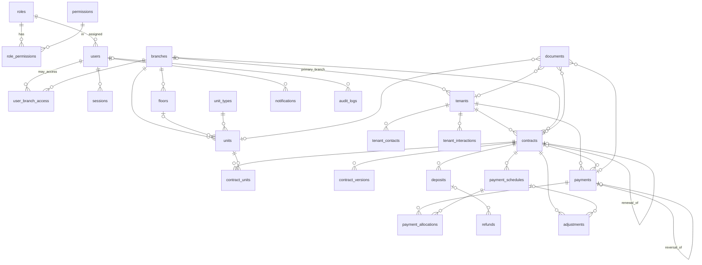

# مخطط قاعدة البيانات

المصدر: `prisma/schema.prisma` + `prisma/migrations/*_constraints/migration.sql`.
أُنشئت جميع الجداول الآن (حتى جداول المراحل القادمة) لتثبيت التصميم مبكرًا واختبار قيوده، لكن **الشاشات والخدمات** للعقود والتحصيل لم تُبنَ بعد.

## العلاقات

جداول إضافية: `login_attempts` (تحديد المحاولات)، `number_sequences` (ترقيم العقود والإيصالات بلا فجوات داخل المعاملة)، `system_settings`.

## قيود السلامة على مستوى قاعدة البيانات (مختبرة)

| القيد | الغرض |
|---|---|
| `contract_units_no_overlap` (EXCLUDE + btree_gist) | يمنع تأجير وحدة حصرية لعقدين في فترات متداخلة (الفترة `[start,end]` مغلقة). ينطبق فقط عندما `blocks_occupancy = true` (عقد بانتظار الاعتماد/نشط) — المسودات لا تحجز. آمن تحت التزامن. |
| `payments_method_reference_unique` | يمنع تسجيل نفس عملية الدفع مرتين (الوسيلة + رقم المرجع، دون حساسية للأحرف والمسافات). |
| `payments.idempotency_key` UNIQUE | يمنع النقر المزدوج/إعادة الإرسال. |
| `payments_protect_approved` (Trigger) | الدفعة المعتمدة لا تُحذف ولا تُعدَّل؛ التصحيح فقط بالعكس (REVERSED + قيد عكسي). |
| `payment_allocations_protect` (Trigger) | توزيع دفعة معتمدة لا يُعدَّل. |
| `payments_approval_consistent` | لا اعتماد بدون رقم إيصال ووقت اعتماد. |
| `schedules_amounts_valid` | `amount_due = net + vat` و`paid + adjusted ≤ due`. |
| `audit_logs` / `contract_versions` append-only | يمنع UPDATE/DELETE/TRUNCATE. |
| CHECKs متنوعة | تواريخ صحيحة، مبالغ غير سالبة، السعة ≥ 1، البريد بأحرف صغيرة، المستند مرتبط بكيان. |
| فهارس فريدة جزئية للمستأجرين | منع تكرار السجل التجاري/الهوية/الرقم الضريبي للمستأجرين غير المؤرشفين. |

## قرارات تصميم

- **المال:** `Decimal(14,2)` (حتى 999,999,999,999.99 ر.س).
- **التواريخ:** أعمدة `DATE` للعقود والاستحقاقات (يوم تقويمي بتوقيت الرياض)، و`timestamptz` للأحداث.
- **الوحدات المشتركة:** `occupancy_mode = SHARED` + `capacity` = عدد المقاعد. يُفحص مجموع المقاعد في طبقة الخدمات مع `SELECT … FOR UPDATE` على الوحدة (المرحلة الثالثة).
- **`amount_paid` في الأقساط** قيمة محسوبة مخزنة تُحدَّث في نفس المعاملة مع التوزيعات لسرعة التقارير، ومحمية بقيد CHECK.
- **الأرشفة:** `archived_at`/`is_active` بدل الحذف للفروع والوحدات والمستأجرين والعقود.
- **المستخدمون لا يُحذفون** بل يُعطَّلون (سجل التدقيق مرتبط بهم).
